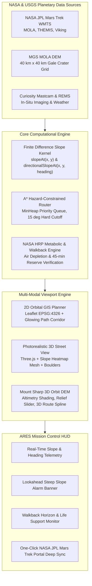
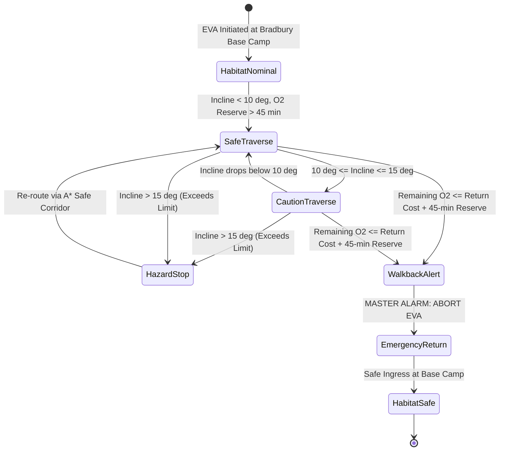
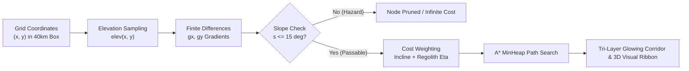

# ARES-OPS: Mars Safe Walk and Planetary Surface Exploration System

**NASA Space Apps Challenge 2026 -- Raipur Local Event**  
**Challenge Statement:** Interplanetary Survival Guide: Martian Map  
**Team:** Kasukabe Defence Group (Deepanki, Anuj, Anmol, Kafi)  
**Primary Science Site:** Mount Sharp (Aeolis Mons), Gale Crater (4.5895 S, 137.4417 E)  
**Primary Geological Target:** Boxwork Formations (Ancient Hydrothermal Vein Network)

---

## 1. Executive Summary and Mission Overview

ARES-OPS is a browser-native planetary surface exploration, safe traverse routing, and Extravehicular Activity (EVA) mission control system designed for human exploration of Mount Sharp in Gale Crater, Mars.

Human astronauts on Mars operate under strict life-support envelopes dictated by the NASA Human Research Program (HRP). Unlike robotic rovers such as Curiosity, which traverse terrain at speeds under 0.15 km/h, human crew members face acute physiological risks:
1. **Critical Slope Thresholds:** Incline grades exceeding 15 degrees cause spacesuit loss-of-traction, slip risks, high metabolic oxygen burn, and suit puncture hazards from knife-edge mineral ridges.
2. **Point of No Return (Walkback Horizon):** NASA flight rules mandate a 45-minute emergency walkback oxygen reserve. Any traverse that exhausts oxygen beyond this reserve leaves the astronaut stranded without life support.
3. **Terrain Traversability Discrepancies:** Orbital imagery alone obscures meter-scale obstacles and micro-topography.

ARES-OPS bridges this gap by unifying multi-mission orbital datasets (NASA MGS MOLA elevation altimetry, NASA 2001 Mars Odyssey THEMIS thermal inertia, NASA Viking optical imagery, and NASA JPL Mars Trek tile streaming) with an interactive 3D Martian Street View and an orbital 3D Digital Elevation Model (DEM). It continuously computes an A* hazard-constrained "Best Safest Shortest Path," projects a Slope Hazard Heatmap directly onto the Martian regolith mesh, and enforces NASA safety flight rules in real time.

---

## 2. Judge and User Evaluation Protocol (Quickstart Guide)

The entire application runs as a self-contained system with zero compilation, package management (no npm/yarn), or external server installation required.

### 2.1 How to Launch
1. Open the project root directory.
2. Double-click `index.html` or open it in any modern web browser (Google Chrome, Microsoft Edge, Mozilla Firefox, Brave, Safari).
3. The application will initialize with an authentic orbital alignment intro, verify local Gale Crater DEM datasets, and immediately transition into the 3D Martian Street View.
4. For printable documentation, open `NASA_SpaceApps_MartianMap_Guide_Kasukabe.html` and use the print dialog to export a formatted mission report.

### 2.2 Step-by-Step Evaluation Walkthrough

#### Step 1: Evaluate the 3D Martian Street View
* **Navigation:** Click on the white ground chevron or click anywhere on the Martian surface to glide forward. Use keyboard keys (`W`, `A`, `S`, `D`, `Q`, `E`) or the on-screen virtual D-Pad.
* **360-Degree Panorama:** Click and drag across the viewport to inspect the Gale Crater horizon and Mount Sharp peaks.
* **3D Astronaut Avatar:** Toggle the `Mode: 3D Avatar` button in the top-right HUD to switch between first-person helmet view and third-person spacesuit avatar mode.
* **Interactive Waypoint Beacons:** Floating 3D beacons display real-time line-of-sight distance to key science sites (Bradbury Base Camp, Pahrump Hills, Vera Rubin Ridge, Boxwork Ridge, Gediz Vallis). Clicking any beacon glides the astronaut toward it.

#### Step 2: Test Ground Slope Accuracy and Slope Hazard Heatmap
* In the top-right HUD pills, locate the `Slope Heatmap: ON` button (active by default).
* Observe the ground mesh coloring:
  * **Green Zone (<10 degrees):** Safe nominal traverse.
  * **Amber Zone (10 to 15 degrees):** Caution slope; astronaut speed drops to 1.2 km/h.
  * **Red Zone (>15 degrees):** NASA HRP NO-GO hazard zone representing steep escarpments and unstable regolith.
* Click `Slope Heatmap: ON` to toggle to realistic dusty regolith soil coloring, then click it again to verify instant GPU vertex recoloring.

#### Step 3: Verify Lookahead Steep Slope Alarm
* Steer the astronaut toward an uphill ridge or scarp.
* Observe the live telemetry column 3 (`Ground Slope`): it continuously computes directional incline relative to your heading (e.g., `+7.4 deg Uphill (SAFE)`).
* When approaching terrain steeper than 15 degrees within a 14-meter lookahead window, the system triggers a flashing red alarm banner:
  `HAZARD: STEEP SLOPE AHEAD: +XX.X deg (EXCEEDS 15 deg SUIT LIMIT) -- TURN TO DIVERT`.
* Direct the astronaut away from the incline; the alarm automatically clears once a safe trajectory is resumed.

#### Step 4: Inspect the Best Safest Shortest Path
* Examine the high-visibility navigation corridor rendered on the Martian surface:
  * Illuminated ground ribbon tracking micro-elevations.
  * Cyan boundary edge rails.
  * 18-meter vertical holographic beacon columns at each waypoint stop.
* In the right stack, drag the `Elevation Scrubber` or click points on the `Route Minimap` to immediately scrub the astronaut along the 40-kilometer traverse.

#### Step 5: Test Mount Sharp 3D (Altimetry and Orbit View)
* In the top navigation bar, click `Mount Sharp 3D`.
* The view transitions into a full 40 km by 40 km 3D Digital Elevation Model of Gale Crater and Mount Sharp.
* **Shading Modes:** Click `Shading: MOLA Height` to toggle between continuous MOLA elevation altimetry (crater floor blue to peak white) and slope hazard zones.
* **Vertical Relief Exaggeration:** Adjust the `Relief` slider from `1.0x` to `3.0x` (default `1.6x`) to observe real-time elevation scaling.
* **Camera Presets:** Test `Overview`, `Boxwork`, and `Aerial` preset buttons. Drag with the left mouse button to orbit, right-click/shift-drag to pan, and scroll to zoom.
* **3D Route Spline:** Observe the glowing 3D tubular spline winding up the mountain from Base Camp to Boxwork Ridge and Gediz Vallis.

#### Step 6: Test 2D Orbital Map Planner and NASA Mars Trek Tile Streaming
* In the top bar, click `Map Planner`.
* **Orbital Tile Layers:** In the right panel, select `Shaded relief (MOLA height)`, `Thermal inertia (THEMIS IR)`, or `Optical mosaic (Viking/CTX)` to stream NASA JPL Mars Trek tiles in EPSG:4326.
* **A* Safe Path vs. Straight Legs:** In the left panel, toggle between `Safest path (<15 deg)` and `Straight legs`. Notice how the A* algorithm diverts the route around steep scarps and high-thermal-inertia boulder fields.
* **Interactive Waypoints:** Enable `Click the map to add custom stops` and click on the crater floor to insert custom stops. The route, elevation profile, and flight rules recompute instantly.
* **2D Best Safest Path Corridor:** Observe the triple-layer glowing corridor (outer cyan safety buffer, neon core, and white dashed centerline).

#### Step 7: Verify NASA HRP Flight Rules and Walkback Horizon
* In the bottom sheet, review the `Route Check` card:
  * If the route stays under 15 degrees and preserves the 45-minute reserve, the verdict displays `Safe` in green.
  * If a leg exceeds 15 degrees, the verdict flags `Do not go` in red with specific reason codes.
  * If estimated air consumed exceeds the safe margin, the emergency `ABORT EVA` protocol triggers.

#### Step 8: Test Official NASA JPL Mars Trek Portal Integration
* In the top bar, click `NASA Mars Trek`.
* In Mount Sharp 3D, click `JPL Mars Trek 3D`.
* Both actions open the official NASA JPL Solar System Treks portal focused directly on Gale Crater coordinates.

---

## 3. System Architecture

---

## 4. EVA Safety and Walkback Horizon State Machine

---

## 5. Hazard Routing and Terrain Analysis Pipeline

---

## 6. Mathematical Formulations and NASA Flight Rules

### 6.1 Terrain Incline via Finite Differences
Terrain elevation is modeled analytically over the $40\text{ km} \times 40\text{ km}$ study area based on the central Gale Crater mound geometry and the orthogonal ridge frequencies:

$$\nabla h(x, y) = \left( \frac{\partial h}{\partial x}, \frac{\partial h}{\partial y} \right) \approx \left( \frac{h(x + s, y) - h(x - s, y)}{2s}, \frac{h(x, y + s) - h(x, y - s)}{2s} \right)$$

where $s = 60\text{ m}$ defines the spatial difference baseline. The absolute slope gradient $\theta$ is:

$$\theta = \arctan\left(\sqrt{ \left(\frac{\partial h}{\partial x}\right)^2 + \left(\frac{\partial h}{\partial y}\right)^2 }\right) \cdot \frac{180}{\pi}$$

Directional inclination along the astronaut's active heading vector $\mathbf{u} = (\sin \psi, \cos \psi)$ is evaluated across a local $8\text{ m}$ step baseline:

$$\theta_{\text{dir}} = \arctan\left( \frac{h(x + s_{\text{step}}\sin \psi, y + s_{\text{step}}\cos \psi) - h(x, y)}{s_{\text{step}}} \right) \cdot \frac{180}{\pi}$$

### 6.2 Tobler Martian Hiking Function
Walking speed $v(\theta)$ is adjusted for reduced Martian gravity ($0.38g$), pressurized spacesuit joint resistance, and incline grade:

$$v(\theta) = \begin{cases} 
3.0 \text{ km/h} & \text{if } \theta \le 10^\circ \\
1.2 \text{ km/h} & \text{if } 10^\circ < \theta \le 15^\circ \\
0 \text{ km/h (NO-GO)} & \text{if } \theta > 15^\circ 
\end{cases}$$

### 6.3 Metabolic Cost and Oxygen Consumption
Life support oxygen depletion rate $C_{\text{air}}$ over traverse distance $L$ (in meters) incorporates terrain slope $\theta$ and regolith sinkage impedance factor $\eta$:

$$C_{\text{air}} = \left( \frac{L}{1000} \right) \cdot R_{\text{base}} \cdot \left( 1 + 1.4 \cdot \frac{\min(\theta, 15^\circ)}{15^\circ} \right) \cdot \eta$$

where:
* $R_{\text{base}} = 0.8\%\text{ O}_2\text{ per kilometer}$ on flat, cohesive regolith.
* $\eta = 1.0$ for consolidated bedrock and knife-edge mineral ridges.
* $\eta = 1.25$ for mixed regolith and pebble pavement.
* $\eta = 1.65$ for aeolian dune ripples and loose drift sand.

### 6.4 Walkback Horizon (Point of No Return)
NASA safety protocol requires maintaining a mandatory 45-minute walkback reserve ($R_{\text{reserve}} = 10\%$ of total tank capacity). At any coordinate $(x, y)$, the required return oxygen $C_{\text{return}}$ to Bradbury Base Camp $(x_0, y_0)$ is computed:

$$C_{\text{return}} = C_{\text{air}}\left(\text{Path}(x \to x_0), \bar{\theta}, \bar{\eta}\right)$$

The master abort condition is triggered when:

$$O_{2,\text{remaining}} - C_{\text{return}} \le R_{\text{reserve}}$$

---

## 7. Integrated NASA and USGS Planetary Datasets

| Dataset | Instrument / Mission | Product / Resolution | Application in ARES-OPS |
| :--- | :--- | :--- | :--- |
| **MOLA** | Mars Global Surveyor (MGS) | Global Shaded Altimetry (463 m/px) | 3D orbital mesh generation, elevation climb profile, slope computation |
| **THEMIS IR** | 2001 Mars Odyssey | Thermal Inertia Daytime Mosaic (100 m/px) | Subsurface blockiness, sand vs. bedrock detection in A* routing |
| **MDIM 2.1** | Viking Orbiters 1 & 2 | Controlled Color Optical Mosaic (232 m/px) | True-color surface albedo, regional context |
| **WMTS Tiles** | NASA JPL Solar System Treks | EPSG:4326 OGC Tile Service | Real-time map tile streaming from trek.nasa.gov |
| **Mastcam** | MSL Curiosity Rover | High-Resolution Surface Panoramas | 360-degree Street View horizon sky dome calibration |
| **REMS** | MSL Curiosity Rover | Atmospheric Pressure, Temperature, Dust Tau | Dynamic atmospheric scattering, solar flux, suit thermal metrics |

---

## 8. Strategic Recommendations for Pitch Day and Next Steps

The following high-value enhancements are recommended for team presentation and submission review:

1. **Digital Traverse Manifest Export (GeoJSON / CSV):**
   * Add a one-click button in the 2D Map Planner to export the calculated A* route as standard GeoJSON or NASA PDS-compatible CSV coordinates. This allows judges to verify that the planned traverse can be ingested directly into actual GIS software (e.g., QGIS, ArcGIS, or JMARS).

2. **Solar Transit and Eclipse Simulation:**
   * Gale Crater experiences seasonal transits of Phobos and Deimos across the Martian sun. Enhancing the current real-time sunlight slider to simulate a Phobos solar annular transit would showcase astronomical accuracy.

3. **Rover Vault Core Sampling Log:**
   * Allow the astronaut to tag sample extraction locations along the 3D route. The system can log mineral composition (e.g., smectite clays, jarosite, magnesium sulfates) into an interactive science specimen tray.

4. **WebXR / Head-Mounted Display Support:**
   * Because Three.js already powers the 3D Street View and Mount Sharp DEM, enabling the WebXR API would allow judges with VR headsets (e.g., Meta Quest, Apple Vision Pro) to experience the Martian surface in full stereoscopic virtual reality.

---

## 9. Team Kasukabe Defence Group

* **Deepanki:** Project Lead, Systems Architecture, Boxwork Geological Objectives, Presentation Narration.
* **Anuj:** Geospatial Engine, Leaflet GIS Architecture, NASA Mars Trek WMTS Integration.
* **Anmol:** UI/UX Design System, Aerospace Telemetry Displays, 3D Mesh Styling.
* **Kafi:** Quantitative Physiology Pipeline, Tobler Martian Hiking Function, Metabolic and Walkback Physics Engine.

---
*Developed for the NASA Space Apps Challenge 2026. Built entirely with open planetary science data and browser-native standards.*
